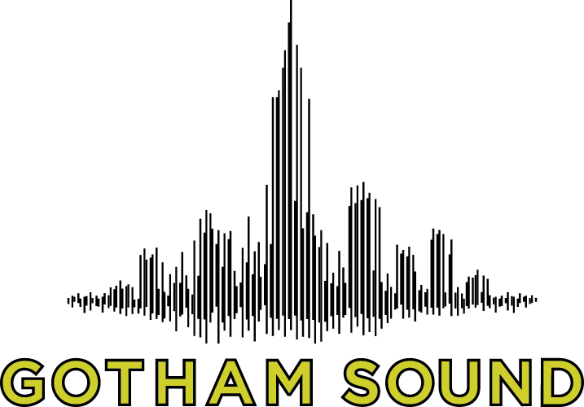
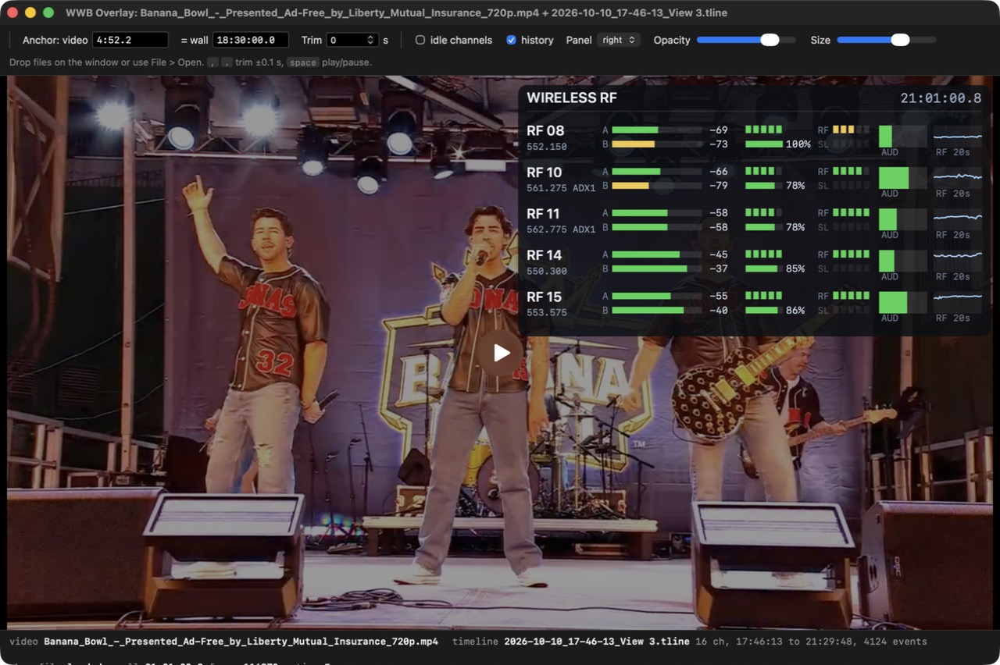
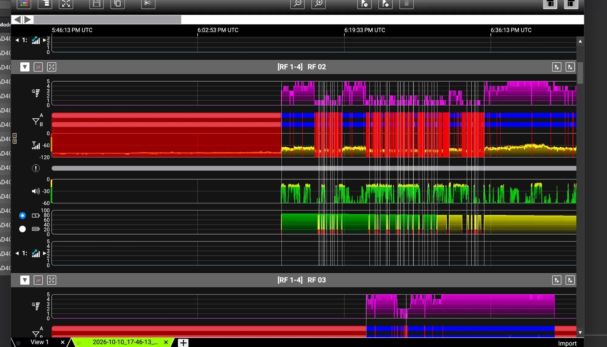
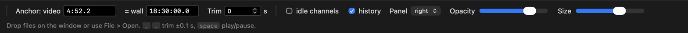
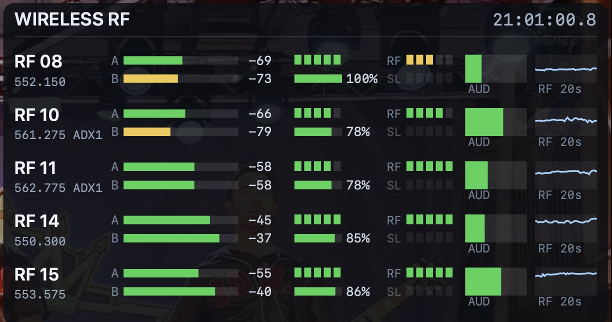
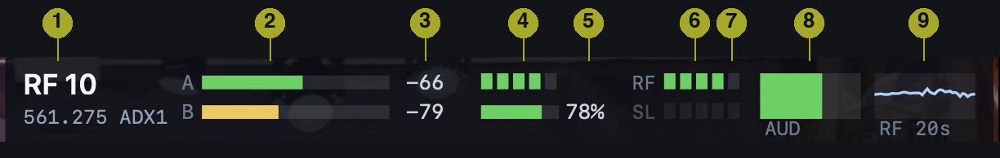
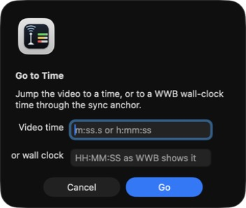
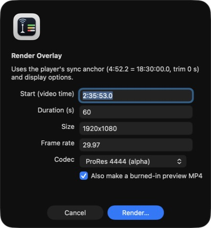
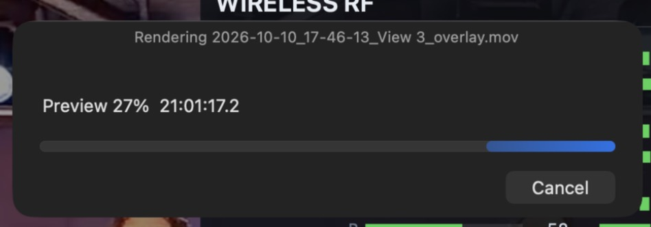
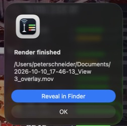

# WWB Overlay manual

<picture>
  <source media="(prefers-color-scheme: dark)" srcset="img/gotham-logo-dark.png">
  
</picture>

WWB Overlay puts the RF telemetry that Shure Wireless Workbench records during a show on top of the show's video, in sync. You load a video, a Timeline recording and the show file, tell it one moment where the two timelines meet, and a translucent dashboard of every live wireless channel follows playback. When you need it in an edit, it renders the same dashboard as a movie with an alpha channel for Resolve, Final Cut or Premiere.



## Contents

1. [What you need](#what-you-need)
2. [Install](#install)
3. [Get the files out of Wireless Workbench](#get-the-files-out-of-wireless-workbench)
4. [Load files](#load-files)
5. [Set the sync anchor](#set-the-sync-anchor)
6. [Read the dashboard](#read-the-dashboard)
7. [Move around](#move-around)
8. [Display options](#display-options)
9. [Render an overlay for your editor](#render-an-overlay-for-your-editor)
10. [Command line](#command-line)
11. [Troubleshooting](#troubleshooting)
12. [What the Timeline records](#what-the-timeline-records)

## What you need

- A Mac on macOS 13 or later, Apple silicon or Intel.
- The video of the show. Anything QuickTime can play: an MP4 or MOV from the broadcast, a program record, a phone clip.
- The Timeline recording from Wireless Workbench, a `.tline` file.
- The show file from the same show, a `.shw` file. Optional, but it adds frequencies and transmitter names to the dashboard.
- One moment you can identify in both the video and the clock Wireless Workbench was running on. A countdown hitting zero, a mic being switched on, a cue you can hear. See [Set the sync anchor](#set-the-sync-anchor).

Verified so far on Axient Digital AD4Q receivers with Wireless Workbench 7.9. Other receivers probably work; if you have a recording from one, please share it through the project's issue tracker.

## Install

1. Download `WWB-Overlay-x.y.z-macOS.zip` from the [Releases](https://github.com/Gotham-Sound/wwb-timeline-overlay/releases) page.
2. Unzip it and move `WWB Overlay.app` to your Applications folder.
3. Open it. The app is signed and notarized, so macOS opens it without complaint. If you ever see the "downloaded from the internet" dialog anyway, click Open.

Nothing else is needed. The app has no dependencies, installs nothing, and does not touch your Wireless Workbench installation.

## Get the files out of Wireless Workbench

**The Timeline recording.** Wireless Workbench's Timeline tab records RF, audio, battery and events for every channel while it runs. Start it before the show and stop it after. Use Save (or Save As) in the Timeline toolbar to keep the recording; by default it lands in `Documents/Shure/Timeline/` with the date and time in the file name, for example `2026-10-10_17-46-13_View 3.tline`.



The Timeline's clock is the clock of the computer running Wireless Workbench. The display labels it UTC, but it is that computer's local time; the overlay follows the same convention, so you never convert anything. It does mean that a laptop with a wrong clock produces a recording with a wrong clock. The sync anchor absorbs a constant offset, so this is not fatal, but it is worth setting the laptop's clock before a show.

**The show file.** File > Save in Wireless Workbench writes the `.shw` show file. The overlay reads the receiver model, each channel's frequency and the linked transmitter from it and matches channels to the recording by the receiver's hardware ID, so stale entries from earlier shows in the same file do no harm.

## Load files

Drop the video, the `.tline` and the `.shw` anywhere on the window, together or one at a time. The window title lists what is loaded, and the status bar at the bottom shows the recording's time span and event count. File > Open does the same thing through a dialog, and double-clicking a `.tline` or `.shw` file in the Finder opens the app with it.

Each file type replaces the previous one of its kind, so you can swap in a different video and keep the recording.

## Set the sync anchor

The video has a time of its own, starting at zero. The recording has wall-clock times. The anchor is one pair of those: a video time and the wall-clock time it corresponds to. Everything else follows from it.



1. Find a moment you can place in the video: a countdown reaching zero, a visible mic switch-on, the first word of a national anthem. Note its video time, for example `4:52.2`.
2. Find the wall-clock time of that moment as Wireless Workbench knew it. For a broadcast countdown that ends on the hour, that is the hour. For a mic switch-on, the recording's own event log has it: the System events tab in Wireless Workbench lists "Active Transmitter" events to the tenth of a second.
3. Type both into the anchor fields. The clock in the dashboard header now shows the wall-clock time for wherever the video is.
4. Fine-tune with Trim, in seconds, or the `,` and `.` keys which nudge by a tenth. Scrub to a moment with an audible dropout or a mic being keyed and watch the dashboard until the RF DROP flash or the audio meter lines up with what you hear.

The anchor and trim are remembered between launches.

A check you can run afterwards: the `audiocheck.py` script in the repository correlates the program audio of a segment with the receivers' audio meters and reports the lag at which they agree best. On a stretch where a mic is clearly in the mix it lands within a few tenths of a second of a good anchor.

## Read the dashboard



The header shows the wall-clock time for the current video position. Below it, one row per channel that has a transmitter on the air. Channels with no transmitter are hidden unless "idle channels" is checked, in which case they appear dimmed.



1. **Channel name** as set in Wireless Workbench, with the frequency in MHz and the linked transmitter's name from the show file underneath.
2. **RF level per antenna**, A and B, on a scale from -120 to -20 dBm. Green above -70, yellow to -85, red below. Quadversity receivers' C and D antennas are recorded but not drawn.
3. **The same levels in dBm**, to the nearest dB.
4. **Channel quality**, Shure's 0 to 5 scale, as five pips. Green at 4 and 5, yellow at 2 and 3, red at 1.
5. **Battery**, as a bar with the percentage when the transmitter reports one. Green above 30 percent, yellow to 15, red below.
6. **The receiver's own RF meter**, 0 to 5, the same bars the receiver's front panel shows.
7. **ShowLink signal**, 0 to 5, lit blue when a ShowLink access point is in the rig. Dimmed when there is none.
8. **Audio level** from -60 to 0 dB, green to -18, yellow to -6, red above.
9. **RF history**, the stronger antenna's level over the last 20 seconds, with every "No RF Connection" event in that window as a red bar scaled to its duration.

When the event log says a channel lost all antennas, the row flashes red and shows **RF DROP** for the event's duration plus half a second, so even a 100 ms dropout is visible at playback speed.

Two other states appear in the panel. **No active transmitters** means the recording has data for this moment but nothing was on the air. **No telemetry** means the video position maps to a wall-clock time outside the recording; the message shows the recording's span so you can tell which side you are on.

## Move around

Space plays and pauses. The video's own controls scrub and seek. File > Go to Time (Command-G) jumps to either a video time or a wall-clock time; the wall-clock option goes through the anchor, so you can type a time straight from Wireless Workbench's event list and land on it in the video.



## Display options

- **idle channels** shows channels without a transmitter, dimmed.
- **history** turns the 20 second RF strips on and off.
- **Panel** puts the dashboard on the left or right of the frame.
- **Opacity** sets the panel's translucency.
- **Size** scales the whole panel. The default size is designed around a 1280 px wide frame and scales with the video.

These options are remembered, and the renderer uses the same ones.

## Render an overlay for your editor

File > Render Overlay (Command-R) writes the dashboard as a movie with an alpha channel, one frame per video frame, using the anchor and display options the player is showing.



- **Start** defaults to the current video position; **Duration** is in seconds.
- **Size** and **Frame rate** should match your edit. Fractional rates are written exactly: 29.97 means 30000/1001.
- **Codec**: ProRes 4444 is the safe choice for any NLE and runs about 8 MB per second at 1080p. HEVC with alpha is a hundred times smaller because most of each frame is transparent; Resolve 17 and later and Final Cut read it, so check your editor before relying on it. PNG sequence writes one transparent image per frame into a folder.
- **Also make a burned-in preview MP4** composites the dashboard onto the video for the same range and keeps the program audio, as an H.264 file next to the overlay. Handy for sending someone a look without an edit session.

Click Render, choose where to save, and a progress panel follows the frames. Cancel stops it and leaves no partial file behind. When it is done you can reveal the file in the Finder.





**In the edit.** Put the overlay on a track above the program video and align its first frame with the video frame you rendered from. The alpha channel is picked up automatically from ProRes 4444; if an editor asks, it is straight alpha. Rendering from the video's first frame, with the duration set to the whole program, gives a single clip you can drop on top of the whole timeline, at about 8 MB per second for ProRes or under 100 KB per second for HEVC.

## Command line

The app's executable also runs headless, with the same flags as the Python renderer in the repository:

```bash
"/Applications/WWB Overlay.app/Contents/MacOS/WWB Overlay" --render \
    --tline "Documents/Shure/Timeline/2026-10-10_17-46-13_View 3.tline" --shw show.shw \
    --anchor-video 4:52.2 --anchor-wall 18:30:00 \
    --start 2:35:53 --duration 120 --size 1920x1080 --fps 59.94 \
    --codec hevc --out overlay.mov --burn-in program.mp4
```

| Flag | Meaning |
|---|---|
| `--tline`, `--shw` | the recording and, optionally, the show file |
| `--anchor-video`, `--anchor-wall`, `--trim` | the sync anchor, as in the player |
| `--start`, `--duration` | video time to start at and seconds to render |
| `--size`, `--fps` | output size and frame rate (`23.976`, `29.97`, `59.94` are exact) |
| `--codec` | `prores`, `hevc` or `png` |
| `--out` | the movie to write, or the folder for a PNG sequence |
| `--burn-in`, `--burn-out` | program video to composite a preview onto, and where to write it |
| `--scale`, `--opacity`, `--side`, `--show-idle`, `--no-history` | display options |

The repository also has the tools the app grew out of: `tline.py` decodes a recording and exports CSV for spreadsheets or other software, `player.html` is the same player in a web browser, `render.py` renders with Python and ffmpeg, and `audiocheck.py` validates meters and sync against program audio. See the README.

## Troubleshooting

**The panel says "No telemetry" everywhere.** The anchor maps the video to a time outside the recording. Check the wall-clock field for AM and PM, and remember that the recording's clock is the Wireless Workbench computer's local time, however the display labels it.

**The panel says "Anchor not set".** One of the anchor fields is empty or unreadable. Video times are `m:ss.s` or `h:mm:ss`; wall-clock times are `HH:MM:SS` with an optional tenth.

**The dashboard is empty during the show.** No transmitter was on the air at that moment according to the receivers, which is also useful to know. Turn on "idle channels" to see the receivers listening.

**RF DROP flashes the moment a mic comes on.** The event log closes a long "No RF Connection" event when the transmitter appears, and the flash holds for half a second past the end. It is the end of the idle period, not a dropout.

**ShowLink is dimmed on every row.** The rig had no ShowLink access point, so the receivers never reported a ShowLink level. The RF meter next to it is unaffected.

**Channel names or frequencies are wrong.** The show file is matched to the recording by receiver hardware ID. If the show file comes from a different rig, or receivers were swapped after it was saved, the lookup fails for those channels and the dashboard falls back to the names in the recording.

**My editor shows the HEVC overlay without transparency.** Not every version reads HEVC alpha. Render ProRes 4444 instead.

**Rendering is slow.** Rendering keeps the machine awake and runs at full speed in the background from version 0.2 on. Expect roughly 80 frames per second at 1080p on an Apple silicon Mac, including the burned-in preview. The first frame of a long render can take a moment while the recording is indexed.

**The app will not open a video.** It plays whatever QuickTime plays. For a format QuickTime does not handle, transcode to H.264 or ProRes first.

## What the Timeline records

Per channel, every 100 ms: RF level for up to four antennas in tenths of a dBm, audio level in dB, channel quality 0 to 5, battery bars 0 to 5 and battery percent, the receiver's RF meter 0 to 5, and the ShowLink level 0 to 5. Every 4 seconds the recording also keeps the minimum and maximum per antenna for the window. A separate event log holds RF dropouts, transmitter on and off events, RF power and frequency diversity changes, each with start and end times to the millisecond.

The file format is not documented by Shure. The decoder was reverse-engineered and verified on recordings from AD4Q receivers; the notes at the top of `tline.py` in the repository say exactly what was confirmed and what is still a guess. Four bytes per channel that only carry data when a ShowLink access point is present remain unmapped.

This project is not affiliated with or endorsed by Shure. Wireless Workbench, Axient and ShowLink are trademarks of Shure Incorporated.
